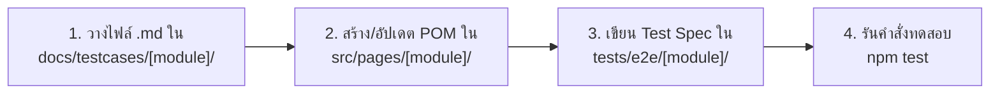

# 🎭 Playwright Automation Framework (JavaScript ES Modules)

โปรเจกต์โครงสร้าง Playwright (JavaScript ES Modules) มาตรฐานระดับ Enterprise ที่ขับเคลื่อนด้วยเอกสาร Test Case ในรูปแบบ Markdown (`.md`) โดยใช้ตัวอย่างจริง **ระบบค้นหาและกรองโพสต์ (TC-SEARCH Series)**

---

## 📁 โครงสร้างโปรเจกต์ (Project Structure)

```text
playwright-project/
├── docs/
│   └── testcases/               # 📄 แหล่งรวมไฟล์เอกสาร Test Case (.md)
│       ├── template.md          # เทมเพลตมาตรฐานสำหรับนำไปสร้าง Test Case ใหม่
│       └── search/
│           └── TC-SEARCH_search_and_filter.md # เอกสาร Test Case ระบบค้นหา/กรอง
│
├── src/
│   ├── config/                  # ⚙️ การตั้งค่า Environment และ Constants
│   │   ├── env.js               # ตัวแปรระบบ / URLs
│   │   └── constants.js         # ค่าคงที่ เช่น Timeouts, Routes
│   ├── fixtures/                # 🧩 Custom Fixtures (Auto-inject Page Objects)
│   │   └── base.fixture.js      # Base Test Fixture (searchPage, logger)
│   ├── pages/                   # 🏛️ Page Object Model (POM)
│   │   ├── base.page.js         # Base Class รวม Safe Actions (safeClick, fillText, getText, screenshot)
│   │   └── search/
│   │       └── search.page.js   # Locators & Actions ของหน้าระบบค้นหาและตัวกรอง
│   └── utils/                   # 🛠️ Helpers & Logger
│       └── logger.js
│
├── tests/                       # 🧪 Test Scripts (แมปตรงกับ docs/testcases/ 1 ต่อ 1)
│   ├── e2e/                     # End-to-End Tests
│   │   └── search/
│   │       └── TC-SEARCH_search_and_filter.spec.js # สคริปต์ทดสอบ TC-SEARCH-01 ถึง 07
│   └── api/                     # API Tests
│       └── auth/
│           └── TC-003_api_auth.spec.js
│
├── test-data/                   # 📊 Mock Data & Datasets (JSON)
│   └── search.json              # ข้อมูลคำค้นหา, ระดับการศึกษา, หมวดวิชา, Mock Posts
│
├── .github/
│   └── workflows/
│       └── playwright.yml       # 🚀 CI/CD Pipeline (GitHub Actions)
│
├── .env.example                 # ตัวอย่าง Environment Config
├── .env                         # ค่า Config จริง
├── playwright.config.js         # การตั้งค่า Playwright (JavaScript ES Modules)
├── jsconfig.json                # JavaScript IntelliSense & Autocomplete Config
└── package.json                 # คำสั่งและ Dependencies
```

---

## 📑 รายละเอียดชุดทดสอบ (TC-SEARCH Series)

| Test Case ID | Description (รายละเอียด) | Expected Result (ผลลัพธ์ที่คาดหวัง) |
| :--- | :--- | :--- |
| **TC-SEARCH-01** | ค้นหาด้วยคำค้นหาที่ถูกต้อง [Positive] | แสดงรายการโพสต์ที่ตรงกับคำค้นหา และช่องค้นหายังแสดงคำที่พิมพ์ |
| **TC-SEARCH-02** | ค้นหาด้วยคำค้นหาที่ไม่มีในระบบ [Negative] | แสดงหน้า Empty State "ไม่พบโพสต์ที่ตรงกับตัวกรอง" |
| **TC-SEARCH-03** | กรองระดับชั้น: มัธยมศึกษาตอนต้น [Positive] | แสดงเฉพาะโพสต์ที่มี Badge "มัธยมศึกษาตอนต้น" |
| **TC-SEARCH-04** | กรองระดับชั้น: มัธยมศึกษาตอนปลาย [Positive] | แสดงเฉพาะโพสต์ที่มี Badge "มัธยมศึกษาตอนปลาย" |
| **TC-SEARCH-05** | กรองระดับชั้น: มหาวิทยาลัย [Positive] | แสดงเฉพาะโพสต์ที่มี Badge "มหาวิทยาลัย" |
| **TC-SEARCH-06** | กรองหมวดหมู่วิชา (เช่น วิทยาศาสตร์) [Positive] | แสดงเฉพาะโพสต์ที่มี Badge ตรงกับวิชาที่เลือก |
| **TC-SEARCH-07** | กรองระดับชั้นและหมวดหมู่วิชา พร้อมกัน [Positive] | แสดงเฉพาะโพสต์ที่ตรงกับทั้ง 2 เงื่อนไข (ม.ปลาย + คณิตศาสตร์) |

---

## 🧭 Workflow: วิธีนำไฟล์ `.md` มาสร้าง Test Script



---

## 🚀 คำสั่งการรันแบบต่างๆ (NPM Commands)

| คำสั่ง | รายละเอียด |
|---|---|
| `npm test` | รันชุดทดสอบทั้งหมดแบบ Headless |
| `npm run test:search` | รันเฉพาะชุดทดสอบระบบค้นหาและกรองโพสต์ (TC-SEARCH) |
| `npm run test:api` | รันเฉพาะ API Tests ทั้งหมด |
| `npm run test:headed` | รันแบบเปิดหน้าต่างบราวเซอร์จริงให้เห็นการทำงาน |
| `npm run test:ui` | เปิด **Playwright Interactive UI Mode** (Time Travel Debugging สะดวกมาก) |
| `npm run test:debug` | รันโหมด Debugging พร้อม Playwright Inspector |
| `npm run test:report` | เปิดดู HTML Report สรุปผลการทดสอบ พร้อมวิดีโอและ Screenshot |
| `npm run test:chromium` | รันเฉพาะบนเบราว์เซอร์ Google Chrome / Chromium |
| `npm run test:firefox` | รันเฉพาะบน Firefox |
| `npm run test:webkit` | รันเฉพาะบน Safari WebKit |
